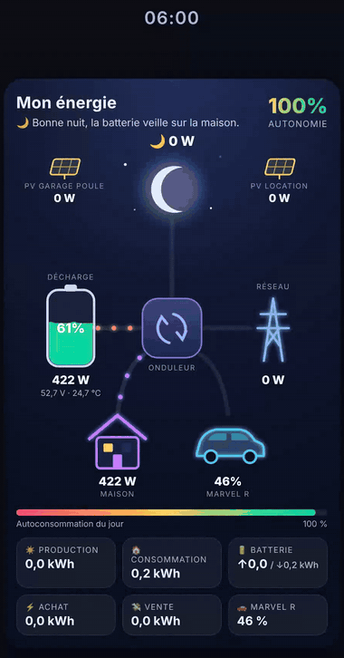
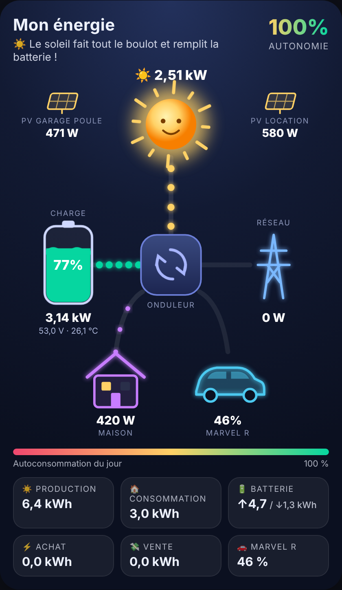
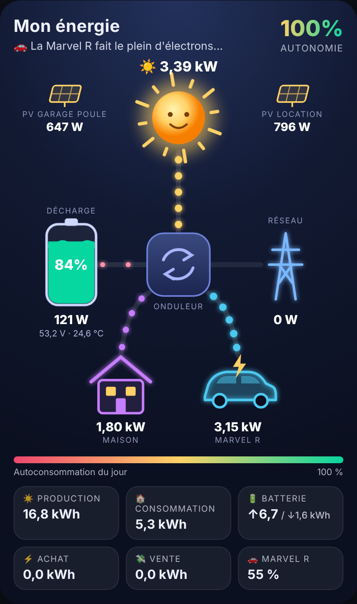
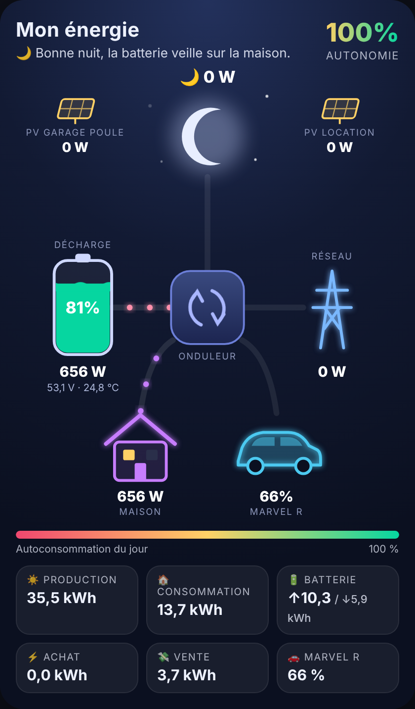
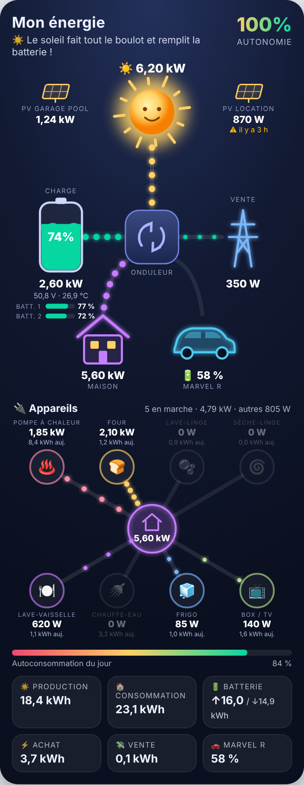

# Energie Flow Card

🇬🇧 English version: [README.md](README.md)

Une carte Home Assistant animée : soleil, batterie, réseau, maison et voiture, avec l'énergie qui circule en temps réel.

## Ce que fait la carte

- **Les flux d'énergie en direct** : des points lumineux circulent sur chaque câble ; plus la puissance est forte, plus ils sont gros et rapides.
- **Le soleil le jour, la lune et les étoiles la nuit**, d'après `sun.sun` de Home Assistant ; le soleil tourne plus vite quand les panneaux produisent.
- **Une batterie animée** dont le niveau ondule comme un liquide, qui passe à l'orange puis au rouge quand elle est basse, avec tension et température.
- **Le réseau** : achat ou vente, visible d'un coup d'œil.
- **La voiture électrique** : son pourcentage de batterie toujours affiché, et un éclair avec la puissance pendant la charge.
- **Deux batteries ?** Le niveau de chacune s'affiche sous la batterie principale.
- **Jusqu'à 8 appareils** (pompe à chaleur, four, lave-linge…) autour de la maison, avec leur consommation en direct ; ceux à l'arrêt passent en gris.
- **Des installations solaires en plus** (garage, dépendance…), avec une alerte si l'une d'elles ne répond plus.
- **Une phrase d'humeur** qui résume la situation (« Le soleil fait tout le boulot… »).
- **L'autonomie en temps réel**, la barre d'autoconsommation du jour et le bilan de la journée.

  
  
  

<em>Le jour · La voiture en charge · La nuit</em>

## Installation

1. Copie `energie-flow-card.js` dans le dossier `/config/www/` de Home Assistant.
2. Paramètres > Tableaux de bord > ⋮ > Ressources > Ajouter une ressource :
   - URL : `/local/energie-flow-card.js?v=1`
   - Type : Module JavaScript
3. Sur ton tableau de bord : Modifier > Ajouter une carte > Manuel, puis colle le contenu de `exemple_config.yaml`.
4. Remplace les `sensor.xxx` par tes propres capteurs et enregistre.

## Mettre à jour

Tu as déjà la carte ? Remplace le contenu de `/config/www/energie-flow-card.js` par la nouvelle version, puis dans Paramètres > Tableaux de bord > Ressources, augmente le numéro de l'URL (`?v=1` devient `?v=2`, etc.) et recharge la page. Ta configuration actuelle continue de marcher telle quelle : les nouveautés ne s'affichent que si tu les ajoutes.

## En cas de souci

**Les points vont dans le mauvais sens (batterie ou réseau).** Selon les marques, un capteur peut compter la charge en positif ou en négatif. Si la carte affiche « charge » alors que ta batterie se décharge, remplace `invert_battery: false` par `invert_battery: true` dans la configuration. Même chose pour le réseau avec `invert_grid` si « achat » et « vente » sont inversés.

**Tu as remplacé le fichier par une nouvelle version, mais rien ne change.** Le navigateur garde l'ancienne version en mémoire. Dans Paramètres > Tableaux de bord > Ressources, modifie l'adresse : `?v=1` devient `?v=2` (puis `?v=3` à la mise à jour suivante), et recharge la page.
