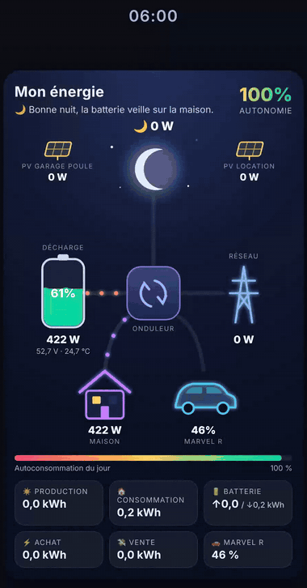
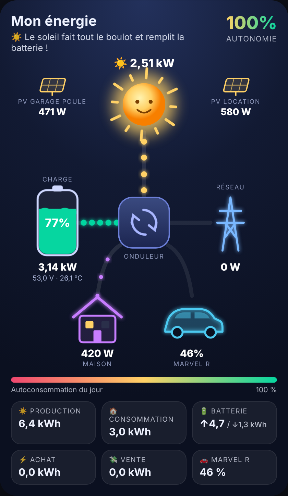
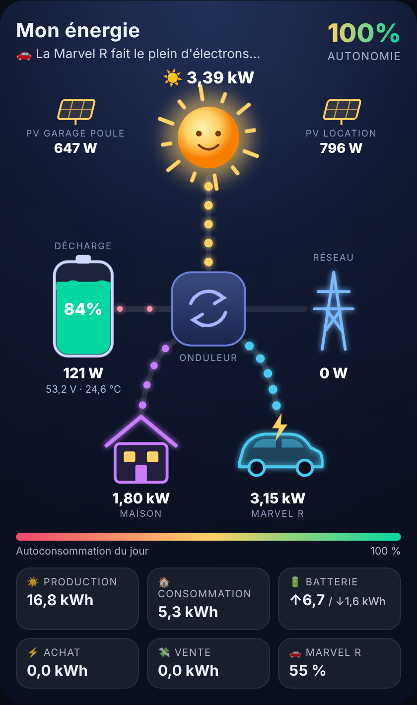
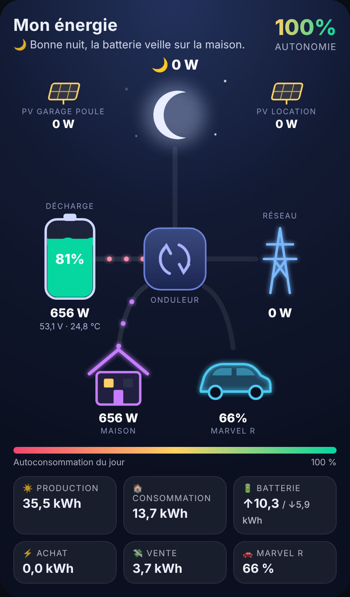
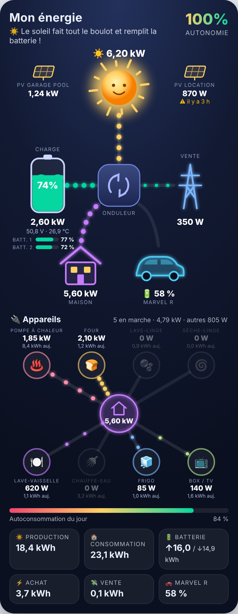
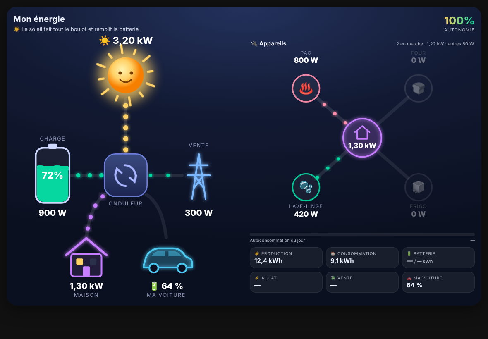

# Energie Flow Card

An animated Home Assistant card: sun, battery, grid, house and car, with energy flowing in real time.

🇫🇷 Version française : [LISEZMOI.md](LISEZMOI.md)

## Features

- **Live energy flows**: glowing dots travel along each cable; the more power, the bigger and faster they go.
- **Sun by day, moon and stars by night**, following Home Assistant's `sun.sun`; the sun spins faster as your panels produce more.
- **Animated battery** whose level ripples like liquid, turning orange then red when it runs low, with voltage and temperature.
- **Grid buying or selling** shown at a glance.
- **Electric car**: its battery level always shown, plus a lightning bolt and charging power while it charges.
- **Two batteries?** Each one's level is shown under the main battery.
- **Up to 8 appliances** (heat pump, oven, washing machine…) around the house, with live power; idle ones turn grey.
- **Extra solar arrays** (garage, outbuilding…), with an alert if one stops reporting.
- **Mood line** that tells you what is going on ("The sun is doing all the work…").
- **Real-time self-sufficiency**, today's self-consumption bar and daily totals.

  
  
  

<em>Daytime · Car charging · Night</em>

## Installation

1. Copy `energie-flow-card.js` into Home Assistant's `/config/www/` folder.
2. Settings > Dashboards > ⋮ > Resources > Add resource:
   - URL: `/local/energie-flow-card.js?v=1`
   - Type: JavaScript module
3. On your dashboard: Edit > Add card > Manual, then paste the content of `exemple_config.yaml`.
4. Replace each `sensor.xxx` with your own sensors and save.

## Updating

Already using the card? Replace the content of `/config/www/energie-flow-card.js` with the new version, then in Settings > Dashboards > Resources bump the URL number (`?v=1` becomes `?v=2`, etc.) and reload. Your existing config keeps working as is: new features only show up if you add them.

## On iPad or a large screen

On a wide screen, Home Assistant lays cards out in several columns, so the card only takes one column. To make it full width, put it on its own in a **Panel** view:

1. Open your dashboard and click the **pencil** at the top right (Edit dashboard).
2. Click the **+** next to the tabs to create a view, and name it e.g. "Energy".
3. Under **View type**, choose **Panel (single card)**, then Save.
4. Add the card to this view (Add card > Manual, then paste your config).

As soon as the card is wider than 700 pixels, it rearranges itself: the diagram on the left, appliances and today's figures on the right. Nothing changes on a phone.

## Troubleshooting

**Your car works as a battery (V2H / V2G) and the flow goes the wrong way.** The card expects a positive power while the car charges and a negative one while it powers the house. If your sensor does the opposite, add `invert_car: true` to the config. When the car feeds power back, the flow goes from the car to the inverter, in green.

**Dots flow the wrong way (battery or grid).** Depending on the brand, a sensor may count charging as positive or negative. If the card shows "charge" while your battery is discharging, change `invert_battery: false` to `invert_battery: true` in the config. Same for the grid with `invert_grid` if buying and selling are swapped.

**You replaced the file with a new version but nothing changes.** Your browser keeps the old version cached. In Settings > Dashboards > Resources, edit the URL: `?v=1` becomes `?v=2` (then `?v=3` next time), and reload the page.

Note: the card's on-screen labels are in French.
